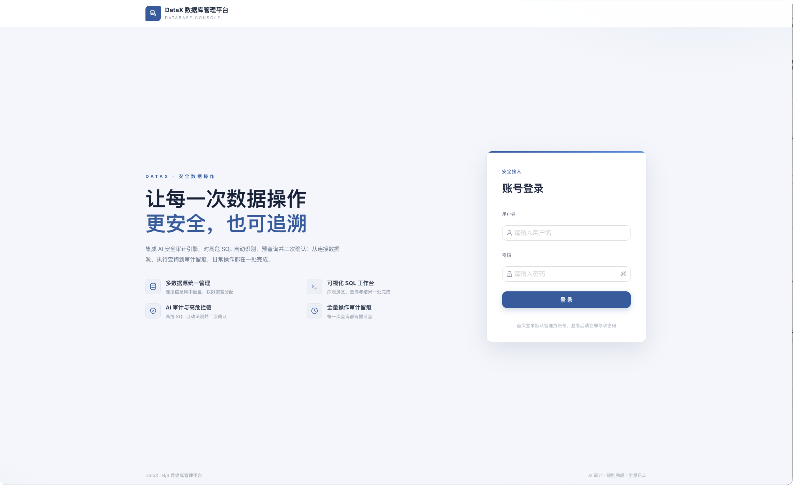
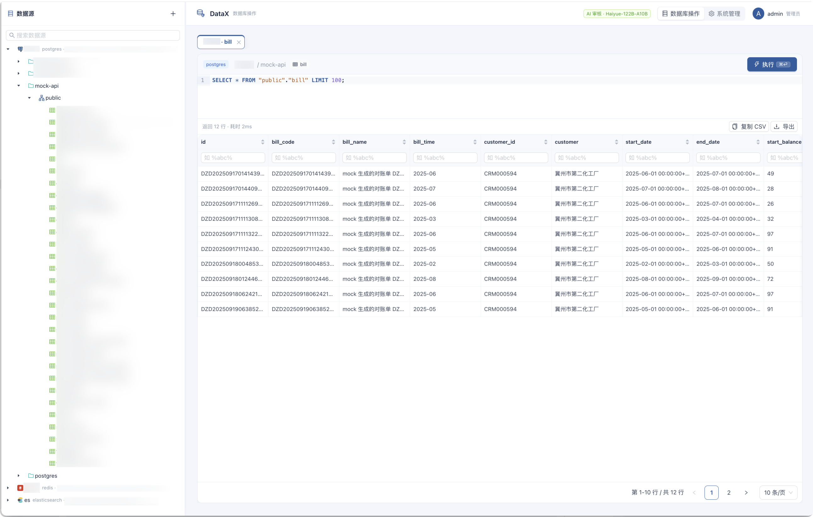

<div align="center">

# DataX

**安全第一的 B/S 数据库管理平台 · 内置 AI SQL 审计**

[](LICENSE)
[](https://nodejs.org/)
[](https://www.typescriptlang.org/)
[](https://react.dev/)
[](https://fastify.dev/)

*让每一次数据操作，更安全，也可追溯*

[功能特性](#功能特性) · [快速开始](#快速开始) · [部署](#部署) · [AI 审计配置](#ai-审计配置) · [Agent 通道](#agent-访问通道) · [API](#api-概览)

</div>

---

DataX 是一个类 Navicat 的浏览器端数据库管理平台：连接数据源、浏览库表、执行 SQL，全程有 **AI 安全审计**兜底——高危 SQL 自动识别、强制先看执行计划、二次确认才能执行，每一步操作都进审计日志。

支持 **MySQL / PostgreSQL / Elasticsearch / Redis**，可部署于 Docker 与 Kubernetes。

## 功能特性

**数据库管理**
- 多数据源统一管理，保存前测试连接，密码 AES-256-GCM 加密存储
- 连接 → 数据库 → Schema → 表/视图 树形浏览，表行数秒开，支持表/字段注释展示
- SQL 编辑器：语法高亮、自动补全、`Cmd/Ctrl+Enter` 执行
- 结果集：列筛选与排序、分页、虚拟滚动、NULL 高亮、CSV/JSON 导出、复制
- ES 数据源：参数化日志搜索（关键词 + 时间范围，无需手拼 DSL）、字段发现、按字段/_id 删除文档（管理员）
- Redis：命令行执行（危险命令黑名单）、按 key 类型自动取值、可视化管理 key

**AI SQL 安全审计**（核心）
- 内置规则引擎（无 AI Key 也可用）+ 可选 LLM（OpenAI 兼容接口）双通道审计
- 高危规则：DROP / TRUNCATE / ALTER / 无 WHERE 的 UPDATE·DELETE / 多语句注入 / 写文件 / 延时注入等
- **高危 SQL 强制先 EXPLAIN 预查询**，展示执行计划与预估影响行数，二次确认后才执行
- 普通用户的高危操作可配置走**管理员审批流**；确认动作由服务端签发的一次性 auditId 背书，不可绕过
- 执行报错时 AI 给出中文诊断与改写建议；慢 SQL 可一键让 AI 分析慢因

**安全与治理**
- JWT 认证 + 首次登录强制改密，登录接口限流防爆破
- admin/user 角色 + 数据源/库级数据权限，管理员可隐藏库表
- 全量审计日志：谁、何时、什么 SQL、风险等级、决策、耗时、结果
- Agent 只读通道：AI agent / 自动化脚本经静态令牌直连，只读三道闸 + 结果截断 + 全量留痕

## 截图






## 环境要求

| 组件 | 版本要求 | 说明 |
|---|---|---|
| Node.js | **≥ 20**（建议 20 LTS 或 22 LTS） | 前后端共用；Docker 镜像基于 node:20 |
| npm | ≥ 10 | 随 Node 附带 |
| Docker | ≥ 24（可选） | 仅容器化部署需要 |

> 以下环境验证通过：**Node v24.18.0 + npm 11.16.0，macOS 27.0.1 (Apple Silicon)**，Docker 镜像在 linux/amd64 下构建运行。

## 快速开始

### 方式一：本地开发（前后端分离）

```bash
# 一键启动（自动装依赖）
./start.sh

# 或手动分步：
# 后端（默认 8080）
cd server
npm install
npm run dev

# 前端（默认 5173，/api 已代理到 8080）
cd web
npm install
npm run dev
# 打开 http://localhost:5173
```

默认账号：`admin / admin123`（首次登录会强制修改密码）。

> 开发环境使用默认密钥时，启动会打印醒目告警；对外部署务必设置 `NODE_ENV=production` 并配置安全密钥（见下文），否则后端拒绝启动。

### 方式二：Docker Compose（生产推荐）

```bash
cd deploy
cp .env.example .env      # 必填：JWT_SECRET / SECRET_KEY / ADMIN_PASSWORD
docker compose up -d --build
# 访问 http://localhost:8080
```

### 方式三：单镜像

```bash
# 前后端一个容器：nginx 托管前端并反代本机 node 后端
./build.sh v1.0.0
docker run -d -p 8080:80 -v datax-data:/app/data \
  -e JWT_SECRET=$(openssl rand -hex 32) \
  -e SECRET_KEY=$(openssl rand -hex 32) \
  -e ADMIN_PASSWORD='your-strong-password' \
  datax:v1.0.0
```

## 部署

### Kubernetes

```bash
# 1. 修改 deploy/k8s/secret.yaml 中的密钥（JWT_SECRET / SECRET_KEY / ADMIN_PASSWORD / AI_API_KEY / AGENT_TOKEN）
# 2. 修改 deploy/k8s/ingress.yaml 中的域名 datax.example.com
kubectl apply -f deploy/k8s/
```

- SQLite 通过 PVC 持久化（单副本写入）；多副本需替换为外部数据库
- 健康检查：`GET /api/system/healthz`

## AI 审计配置

后端通过环境变量或「系统管理 → AI 配置」界面配置（OpenAI 兼容协议，支持 DeepSeek / Qwen / Ollama / vLLM 等）：

| 变量 | 说明 | 示例 |
|---|---|---|
| `AI_BASE_URL` | LLM 接口地址 | `https://api.deepseek.com/v1` |
| `AI_API_KEY` | API Key（界面保存后加密存储） | `sk-xxx` |
| `AI_MODEL` | 模型名 | `deepseek-chat` |
| `AUDIT_MODE` | `strict`（高危必须预查询+二次确认）/ `warn` / `off` | `strict` |

> 不配置 AI 时自动降级为内置规则引擎，核心安全能力（高危识别 + 预查询 + 二次确认）不受影响。

> 隐私提示：strict/warn 模式下，写 SQL 及其报错原文（截断后）会发送到你配置的 LLM 服务。如需数据不出网，请使用内网部署的模型（如 Ollama/vLLM）。

## Agent 访问通道

供 AI agent / 自动化脚本通过 HTTP 直连 datax 执行**只读**查询。完整设计见 [docs/agent-access.md](docs/agent-access.md)。

| 变量 | 说明 | 示例 |
|---|---|---|
| `AGENT_TOKEN` | 静态令牌，逗号分隔可多个；**留空 = 通道禁用** | `openssl rand -hex 32` 生成 |
| `AGENT_WRITE_ENABLED` | `1` 允许 agent 执行写操作（**默认关闭**；开启后仍受单语句限制与高危规则拦截） | `1` |
| `AGENT_WRITE_CONNECTIONS` | 允许 agent 写入的连接 ID（逗号分隔）；留空 = `AGENT_WRITE_ENABLED` 下的全部连接 | `3,5` |

```bash
# SQL 只读查询（JSON / CSV）
curl -s -H "Authorization: Bearer $AGENT_TOKEN" -H 'Content-Type: application/json' \
  -d '{"connectionId":1,"database":"mydb","sql":"SELECT COUNT(*) FROM t"}' \
  http://localhost:8080/api/query/execute

curl -s -H "Authorization: Bearer $AGENT_TOKEN" -H 'Content-Type: application/json' \
  -d '{...}' "http://localhost:8080/api/query/execute?format=csv"

# ES 日志搜索（关键词 + 时间范围，lines 模式返回拼接行）
curl -s -H "Authorization: Bearer $AGENT_TOKEN" -H 'Content-Type: application/json' \
  -d '{"connectionId":2,"index":"logs-*","q":"error","start":"2026-10-30","size":50,"lines":true}' \
  http://localhost:8080/api/es/search

# ES 索引发现
curl -s -H "Authorization: Bearer $AGENT_TOKEN" \
  "http://localhost:8080/api/es/indices?connectionId=2&pattern=*log*"
```

安全语义：agent 只能执行 `SELECT/SHOW/DESCRIBE/EXPLAIN/WITH` 单语句（`EXPLAIN ANALYZE` 因会真实执行而被拒绝，CTE 写操作被全文检测拦截）；`SLEEP()`、`INTO OUTFILE` 等高危模式即使语法合法也会被拒；结果集默认截断 1000 行（`maxRows` 上限 10000）；全部操作写审计日志（decision=`agent_readonly`）。

## 目录结构

```
datax/
├── docs/
│   ├── architecture.md         # 架构设计文档
│   └── agent-access.md         # Agent 只读通道设计
├── server/                     # 后端（Node.js + TypeScript + Fastify + SQLite）
│   └── src/
│       ├── drivers/            # MySQL / PostgreSQL 驱动（ES/Redis 为独立 service）
│       ├── services/           # auth / connection / query / aiAudit / metadata / es / redis
│       ├── routes/             # REST API
│       ├── middleware/         # JWT / AGENT_TOKEN 鉴权
│       └── db/                 # SQLite 存储与迁移
├── web/                        # 前端（React 18 + Vite + AntD 5 + CodeMirror）
│   └── src/
│       ├── pages/              # Login / Workspace / AuditLog / UserManagement / Approvals / AiConfig
│       ├── components/         # ConnectionTree / SqlEditor / ResultTable / AuditConfirmModal ...
│       └── stores/             # zustand
└── deploy/
    ├── docker-compose.yml      # Docker 一键部署
    ├── Dockerfile              # 前后端单镜像
    └── k8s/                    # Kubernetes manifests（namespace/secret/configmap/deployment/ingress）
```

## 常用脚本

| 命令 | 说明 |
|---|---|
| `./start.sh` | 本地一键启动前后端 dev |
| `./build.sh [tag]` | 编译验证 + 构建单镜像（`DOCKER_PUSH=1` 时推送） |
| `cd server && npm run dev` | 后端开发模式（tsx watch） |
| `cd server && npm run build && npm start` | 后端编译 + 运行 |
| `cd server && npm run typecheck` | 后端类型检查 |
| `cd web && npm run dev` / `npm run build` | 前端开发 / 生产构建 |

## API 概览

| 方法 | 路径 | 说明 |
|---|---|---|
| POST | `/api/auth/login` | 登录（5 次/分钟/IP 限流） |
| GET/POST/PUT/DELETE | `/api/connections` | 数据源 CRUD |
| POST | `/api/connections/:id/test` | 测试连接 |
| GET | `/api/metadata/:id/*` | 库/表/视图/列 |
| POST | `/api/query/execute` | 执行（自动 AI 审计；agent token 走只读通道） |
| POST | `/api/query/explain` | EXPLAIN 预查询 |
| POST | `/api/query/confirm` | 二次确认执行 |
| POST | `/api/query/approvals/:id/review` | 管理员审批高危操作 |
| GET | `/api/logs` | 审计日志 |
| GET | `/api/es/indices` | ES 索引列表 |
| POST | `/api/es/search` | ES 参数化搜索 |
| POST | `/api/redis/execute` | Redis 命令执行 |
| GET | `/api/system/healthz` | 健康检查 |

完整鉴权与错误语义（401/403/400）见 [docs/architecture.md](docs/architecture.md) 与 [docs/agent-access.md](docs/agent-access.md)。

## 安全说明

- 数据源密码与 AI API Key 均以 AES-256-GCM 加密存储（密钥来自 `SECRET_KEY`）
- 登录接口限流 5 次/分钟/IP，bcrypt 存储密码，响应时间抹平防用户名枚举
- Redis 命令全员黑名单（`CONFIG SET`/`MODULE LOAD`/`SLAVEOF` 等 RCE 链路命令与阻塞命令）
- ES DSL 全员禁用脚本执行（`script`/`script_fields`/`runtime_mappings`）
- CSV 导出做公式注入防护（`= + @` 前缀转义）
- 生产环境（`NODE_ENV=production`）使用默认密钥/弱口令时**拒绝启动**

## License

[MIT](LICENSE)
